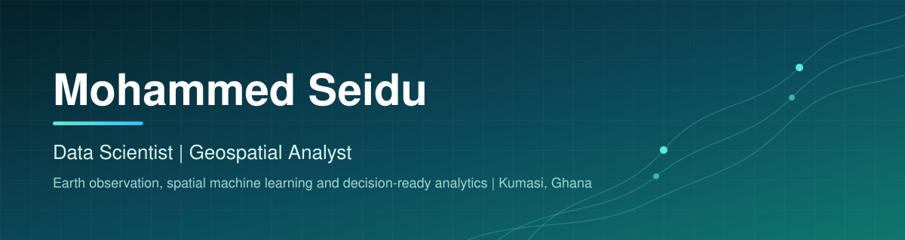

  

  
  
  
  

## 👋 About

I am a data professional who turns satellite imagery, spatial data and operational records into decisions that organisations can act on. My work spans geospatial analysis, machine learning for Earth observation, analytics engineering and full-stack web applications.

I am currently completing an MPhil at KNUST, where my research attributes the drivers of surface urban heat islands using remote sensing and explainable machine learning. Alongside this, I build analytical products for agricultural supply chains, including traceability, deforestation risk and community development reporting.

- 🛰 Researching land surface temperature drivers with Landsat, Google Earth Engine and SHAP-based attribution
- 🗺 Building web GIS tools for flood risk, site selection and deforestation screening
- 📚 Publishing free learning material in Python and climate data analysis
- 💼 Open to data science, geospatial and analytics engineering roles, and to funded PhD opportunities

## 🛠 Technical Stack

  

| Domain | Tools |
| :-- | :-- |
| Geospatial and Earth observation | Google Earth Engine, GeoPandas, Rasterio, QGIS, PostGIS, MapLibre, Mapbox, STAC and COG workflows |
| Data science | pandas, NumPy, scikit-learn, XGBoost, SHAP, statsmodels, Jupyter |
| Data engineering | SQL, PostgreSQL, BigQuery, dbt, Excel and Power Query modelling |
| Web and applications | FastAPI, Next.js, React, Supabase, Azure Functions, Chrome extensions |

## 📊 Data Analysis

I analyse operational, survey and web data to answer specific business questions, and I deliver the results as dashboards and reports that non-technical teams can use.

| Focus | What I do | Tools |
| :-- | :-- | :-- |
| Business intelligence | Interactive dashboards that track costs, field survey progress and community development programmes across agricultural supply chains. | Excel (slicers, Power Query), Power BI, web dashboards |
| Survey and field data | Cleaning, validating and reconciling multi-form survey data, including joins to registry records to resolve missing fields. | Python, pandas, SQL |
| Product and funnel analytics | Funnel, cohort and conversion analysis on event data, with the SQL published as a video series. | BigQuery, GA4 sample data |
| Statistical modelling | Feature selection, multicollinearity checks (VIF), regression and explainable ML with SHAP. | statsmodels, scikit-learn, SHAP |
| Analytics engineering | Staging and mart models with tested, documented transformations. | dbt, PostgreSQL |

**Typical workflow:** define the question, profile and clean the data, build a reproducible pipeline, model or aggregate, then present findings with clear charts and stated limitations.

  
  
  
  
  

## 🚀 Featured Projects

| Project | Description | Stack |
| :-- | :-- | :-- |
| **Wetland and Flood Risk Checker** | Interactive web GIS tool for flood and wetland exposure along coastal Ghana, served as vector tiles directly from PostGIS. | MapLibre, FastAPI, PostGIS |
| **EUDR Plot Screener** | Upload a set of farm polygons and screen them against forest loss data for EU deforestation regulation checks. | FastAPI, Rasterio, Hansen data |
| **Retail Site Selection** | Web GIS application that scores candidate retail locations using demographic and spatial layers. | Mapbox, FastAPI, PostGIS |
| **Warming Signals** | Free climate data practicum with in-browser Python execution across eight modules. | Next.js, Supabase, Pyodide |
| **Python Mastery** | Browser-based Python course with a built-in playground and structured lessons. | Next.js, Supabase, Pyodide |
| **ComDev Cost Dashboard** | Interactive Excel dashboard with slicers for tracking community development costs, built on hidden helper sheets and a clear colour system. | Excel, Power Query |
| **BigQuery Funnel Analysis** | Conversion funnel built on the GA sample dataset, with a scripted video walkthrough. | BigQuery SQL |
| **Cocoa Forest Loss ML** | Machine learning model for forest loss in cocoa landscapes. | Python, scikit-learn |
| **Farm Polygon QA** | Quality assurance checks for farm boundary data. | Python, GeoPandas |

Pin your six strongest repositories above this section so visitors can open the code directly.

## 📈 GitHub Activity

  
  

  

## 🔬 Research Interests

- 🌡 Surface urban heat island drivers and urban climate
- 🤖 Explainable machine learning for Earth observation
- 🌳 Land cover change and deforestation monitoring in tropical agriculture
- 🔁 Open, reproducible geospatial workflows

## 📬 Get in Touch

I welcome conversations about collaboration, research and data roles. The fastest way to reach me is by email at seidumohammed64@gmail.com or through LinkedIn.
